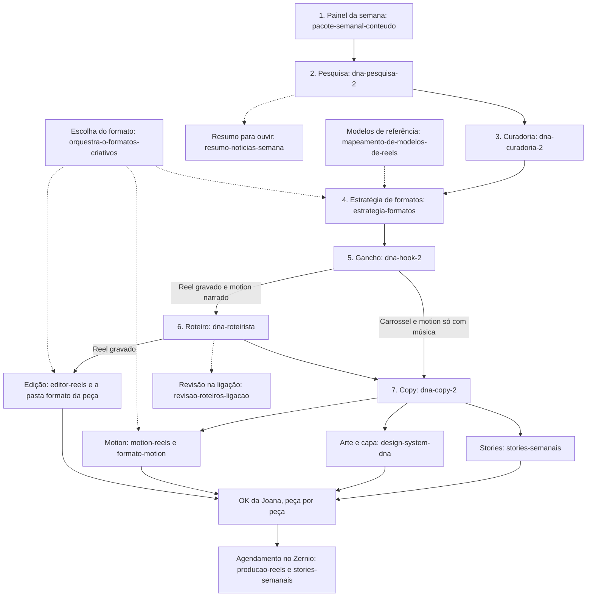

# Biblioteca de skills do Grupo DNA

Este repositório é o fichário das instruções que os agentes da DNA seguem. Cada pasta numerada é um assunto. Dentro dela, cada skill é uma pasta, e o arquivo `SKILL.md` é a receita daquela tarefa.

Não é um programa para instalar e não precisa baixar nada. Dá para ler tudo aqui no site do GitHub.

As pastas, na ordem:

1. [Esteira de conteúdo do Instagram](01-esteira-de-conteudo-instagram/) — da pesquisa até a legenda e os stories
2. [Formatos de Reels](02-formatos-de-reels/) — os jeitos de gravar e contar
3. [Edição de vídeo e motion](03-edicao-de-video-e-motion/) — corte, animação e agendamento
4. [Design e visual](04-design-e-visual/) — cores, capas, fluxos e PDF
5. [Operação e gestão](05-operacao-e-gestao/) — decisões, prazos, envios e o dia a dia
6. [Onboarding e primeiros passos](06-onboarding-e-primeiros-passos/) — a primeira conversa e a instalação
7. [Clientes e parceiros](07-clientes-e-parceiros/) — clínica, centro auditivo e BNI
8. [Ferramentas](08-ferramentas/) — construir página ou sistema no Lovable

## Como navegar no GitHub

Você está na página principal do repositório. O que importa é a lista de pastas e este texto.

1. Clique no nome de uma pasta com número na frente (`01-esteira-de-conteudo-instagram`, por exemplo).
2. Dentro dela, o GitHub mostra os arquivos e, logo abaixo, o `README.md` daquela pasta já em texto corrido. Esse texto diz o que tem ali e como as skills se ligam.
3. Cada skill é uma pasta. Clique nela e depois em `SKILL.md`. Esse arquivo é a instrução. O GitHub mostra o texto formatado. Se aparecer só o código, com `#` no começo das linhas, clique em **Preview**.
4. Para voltar, use a trilha no topo da página (`dna-ia-skills` / nome da pasta) ou a seta do navegador.
5. O botão verde **Code** é para quem programa. Não precisa clicar nele, nem em Download ZIP.

## A esteira do Instagram, na ordem

No domingo a produção dispara nesta ordem, escrita nas próprias skills: Painel, Pesquisa, Curadoria, Estratégia, Gancho, Roteiro, Copy, Arte e Motion. Você grava na segunda. A edição é na terça. A publicação começa na quarta. Cada passo só segue com o seu ok.

Carrossel e motion só com música não passam pelo roteiro: vão do gancho para a copy. Reel gravado e motion narrado passam pelo roteiro.

A seta pontilhada é apoio, não uma etapa que publica. O resumo de notícias só lê a pesquisa. A revisão na ligação muda roteiro e não libera a copy. O mapeamento e a orquestração alimentam a escolha de formato.

Quem entra em cada passo:

| Passo | Skills |
| --- | --- |
| Painel da semana | [pacote-semanal-conteudo](01-esteira-de-conteudo-instagram/pacote-semanal-conteudo/) |
| Pesquisa | [dna-pesquisa-2](01-esteira-de-conteudo-instagram/dna-pesquisa-2/) |
| Curadoria | [dna-curadoria-2](01-esteira-de-conteudo-instagram/dna-curadoria-2/) |
| Estratégia de formatos | [estrategia-formatos](01-esteira-de-conteudo-instagram/estrategia-formatos/), com [orquestra-o-formatos-criativos](02-formatos-de-reels/orquestra-o-formatos-criativos/) e [mapeamento-de-modelos-de-reels](03-edicao-de-video-e-motion/mapeamento-de-modelos-de-reels/) |
| Gancho | [dna-hook-2](01-esteira-de-conteudo-instagram/dna-hook-2/) |
| Roteiro | [dna-roteirista](01-esteira-de-conteudo-instagram/dna-roteirista/). Na ligação: [revisao-roteiros-ligacao](01-esteira-de-conteudo-instagram/revisao-roteiros-ligacao/) |
| Copy | [dna-copy-2](01-esteira-de-conteudo-instagram/dna-copy-2/) |
| Stories | [stories-semanais](01-esteira-de-conteudo-instagram/stories-semanais/), com o texto escrito pela copy |
| Arte e capa | [design-system-dna](04-design-e-visual/design-system-dna/) |
| Motion | [motion-reels](03-edicao-de-video-e-motion/motion-reels/), [formato-motion-narrado](03-edicao-de-video-e-motion/formato-motion-narrado/) e [formato-motion-musica](03-edicao-de-video-e-motion/formato-motion-musica/) |
| Edição do Reel gravado | [editor-reels](03-edicao-de-video-e-motion/editor-reels/) e a pasta `formato-*` da peça |
| Aprovação e agendamento | o ok é seu, peça por peça. O agendamento está em [producao-reels](03-edicao-de-video-e-motion/producao-reels/) e em [stories-semanais](01-esteira-de-conteudo-instagram/stories-semanais/) |
| Mapa de quem faz o quê | [fluxo-da-equipe-de-conte-do](01-esteira-de-conteudo-instagram/fluxo-da-equipe-de-conte-do/) |

A gravação da segunda não é uma skill: o roteiro fica pronto antes, e você grava.

## 01. Esteira de conteúdo do Instagram

A linha de produção da semana. O detalhe de cada formato está na pasta 02. A edição e o motion estão na pasta 03.

| Skill | Para que serve | Usa junto com |
| --- | --- | --- |
| [pacote-semanal-conteudo](01-esteira-de-conteudo-instagram/pacote-semanal-conteudo/) | No domingo, monta o painel do que funcionou nos 7 dias anteriores e para até você decidir. | [estrategia-formatos](01-esteira-de-conteudo-instagram/estrategia-formatos/), [design-system-dna](04-design-e-visual/design-system-dna/), [producao-reels](03-edicao-de-video-e-motion/producao-reels/) |
| [dna-pesquisa-2](01-esteira-de-conteudo-instagram/dna-pesquisa-2/) | Junta o que aconteceu no mercado de IA nos últimos 7 dias, para virar matéria da semana. | [dna-curadoria-2](01-esteira-de-conteudo-instagram/dna-curadoria-2/), [resumo-noticias-semana](01-esteira-de-conteudo-instagram/resumo-noticias-semana/), [fluxo-da-equipe-de-conte-do](01-esteira-de-conteudo-instagram/fluxo-da-equipe-de-conte-do/), [fonte-obrigatoria](05-operacao-e-gestao/fonte-obrigatoria/) |
| [dna-curadoria-2](01-esteira-de-conteudo-instagram/dna-curadoria-2/) | Escolhe as 42 pautas e os 14 stories da semana, sem escrever o texto. | [dna-pesquisa-2](01-esteira-de-conteudo-instagram/dna-pesquisa-2/), [estrategia-formatos](01-esteira-de-conteudo-instagram/estrategia-formatos/), [dna-hook-2](01-esteira-de-conteudo-instagram/dna-hook-2/), [dna-roteirista](01-esteira-de-conteudo-instagram/dna-roteirista/), [dna-copy-2](01-esteira-de-conteudo-instagram/dna-copy-2/), [stories-semanais](01-esteira-de-conteudo-instagram/stories-semanais/) |
| [estrategia-formatos](01-esteira-de-conteudo-instagram/estrategia-formatos/) | Decide quais formatos de Reel repetir e quais testar na semana. | [dna-curadoria-2](01-esteira-de-conteudo-instagram/dna-curadoria-2/), [orquestra-o-formatos-criativos](02-formatos-de-reels/orquestra-o-formatos-criativos/), [mapeamento-de-modelos-de-reels](03-edicao-de-video-e-motion/mapeamento-de-modelos-de-reels/), as pastas `formato-*`, [dna-hook-2](01-esteira-de-conteudo-instagram/dna-hook-2/), [dna-roteirista](01-esteira-de-conteudo-instagram/dna-roteirista/), [dna-copy-2](01-esteira-de-conteudo-instagram/dna-copy-2/) |
| [dna-hook-2](01-esteira-de-conteudo-instagram/dna-hook-2/) | Escreve 5 ganchos por peça, a frase que prende no começo, e indica o melhor. | [dna-curadoria-2](01-esteira-de-conteudo-instagram/dna-curadoria-2/), [estrategia-formatos](01-esteira-de-conteudo-instagram/estrategia-formatos/), [dna-roteirista](01-esteira-de-conteudo-instagram/dna-roteirista/), [dna-copy-2](01-esteira-de-conteudo-instagram/dna-copy-2/) |
| [dna-roteirista](01-esteira-de-conteudo-instagram/dna-roteirista/) | Transforma pauta e gancho em roteiro de Reel para gravar, ou de motion narrado. | [dna-hook-2](01-esteira-de-conteudo-instagram/dna-hook-2/), [dna-copy-2](01-esteira-de-conteudo-instagram/dna-copy-2/), [editor-reels](03-edicao-de-video-e-motion/editor-reels/), [motion-reels](03-edicao-de-video-e-motion/motion-reels/), [formato-motion-narrado](03-edicao-de-video-e-motion/formato-motion-narrado/) |
| [revisao-roteiros-ligacao](01-esteira-de-conteudo-instagram/revisao-roteiros-ligacao/) | Na ligação, lê os roteiros, aplica o que você pedir e só grava regra nova com o seu ok. | [dna-roteirista](01-esteira-de-conteudo-instagram/dna-roteirista/), [dna-hook-2](01-esteira-de-conteudo-instagram/dna-hook-2/), [dna-copy-2](01-esteira-de-conteudo-instagram/dna-copy-2/) |
| [dna-copy-2](01-esteira-de-conteudo-instagram/dna-copy-2/) | Escreve legenda, carrossel, textos de tela, motion e os stories, na sua voz. | [dna-hook-2](01-esteira-de-conteudo-instagram/dna-hook-2/), [dna-roteirista](01-esteira-de-conteudo-instagram/dna-roteirista/), [stories-semanais](01-esteira-de-conteudo-instagram/stories-semanais/), [design-system-dna](04-design-e-visual/design-system-dna/), [motion-reels](03-edicao-de-video-e-motion/motion-reels/) |
| [stories-semanais](01-esteira-de-conteudo-instagram/stories-semanais/) | Define o tom dos stories, gera as imagens e só agenda depois do seu ok. | [dna-copy-2](01-esteira-de-conteudo-instagram/dna-copy-2/), [dna-curadoria-2](01-esteira-de-conteudo-instagram/dna-curadoria-2/) |
| [fluxo-da-equipe-de-conte-do](01-esteira-de-conteudo-instagram/fluxo-da-equipe-de-conte-do/) | Diz quem faz o quê em cada peça e aponta para a esteira. | [dna-pesquisa-2](01-esteira-de-conteudo-instagram/dna-pesquisa-2/), [dna-curadoria-2](01-esteira-de-conteudo-instagram/dna-curadoria-2/), [estrategia-formatos](01-esteira-de-conteudo-instagram/estrategia-formatos/), [dna-hook-2](01-esteira-de-conteudo-instagram/dna-hook-2/), [dna-roteirista](01-esteira-de-conteudo-instagram/dna-roteirista/), [dna-copy-2](01-esteira-de-conteudo-instagram/dna-copy-2/), [stories-semanais](01-esteira-de-conteudo-instagram/stories-semanais/), [editor-reels](03-edicao-de-video-e-motion/editor-reels/), [motion-reels](03-edicao-de-video-e-motion/motion-reels/), [dna-materiais-pdf](04-design-e-visual/dna-materiais-pdf/) |
| [resumo-noticias-semana](01-esteira-de-conteudo-instagram/resumo-noticias-semana/) | Lê a pesquisa e entrega um resumo para você ouvir. Não publica nada. | [dna-pesquisa-2](01-esteira-de-conteudo-instagram/dna-pesquisa-2/) |

## 02. Formatos de Reels

O jeito de contar a história no vídeo. A [orquestração](02-formatos-de-reels/orquestra-o-formatos-criativos/) escolhe o formato. A [estratégia da semana](01-esteira-de-conteudo-instagram/estrategia-formatos/) decide se ele repete ou se é teste. A [edição](03-edicao-de-video-e-motion/editor-reels/) aplica essa gramática no Reel gravado.

Os dois formatos de animação (motion narrado e motion só com música) estão na [pasta 03](03-edicao-de-video-e-motion/), porque a produção deles é animação, não gravação.

| Skill | Para que serve | Usa junto com |
| --- | --- | --- |
| [orquestra-o-formatos-criativos](02-formatos-de-reels/orquestra-o-formatos-criativos/) | Escolhe o formato, a estrutura e os pontos de checagem para a tese virar um Reel. | [estrategia-formatos](01-esteira-de-conteudo-instagram/estrategia-formatos/), [dna-curadoria-2](01-esteira-de-conteudo-instagram/dna-curadoria-2/), [dna-hook-2](01-esteira-de-conteudo-instagram/dna-hook-2/), [dna-roteirista](01-esteira-de-conteudo-instagram/dna-roteirista/), [editor-reels](03-edicao-de-video-e-motion/editor-reels/), [motion-reels](03-edicao-de-video-e-motion/motion-reels/) e todas as pastas `formato-*` |
| [formato-tela-dividida](02-formatos-de-reels/formato-tela-dividida/) | A pessoa fala numa parte da tela e as imagens entram na outra. | Orquestração, estratégia da semana e edição |
| [formato-tela-verde](02-formatos-de-reels/formato-tela-verde/) | A pessoa fica na frente e as imagens de contexto entram atrás. | Orquestração, estratégia da semana e edição |
| [formato-palestrinha](02-formatos-de-reels/formato-palestrinha/) | A fala usa slide, quadro ou tela, como uma mini palestra. | Orquestração, estratégia da semana e edição |
| [formato-cine](02-formatos-de-reels/formato-cine/) | A força está na conversa, no desabafo ou numa imagem que foge do vídeo padrão. | Orquestração, estratégia da semana e edição |
| [formato-narrado](02-formatos-de-reels/formato-narrado/) | A voz conta a história e as imagens mostram o que está acontecendo. | Orquestração, estratégia da semana e edição |
| [formato-storytelling-visual](02-formatos-de-reels/formato-storytelling-visual/) | O que é dito precisa aparecer na imagem para a história fazer sentido. | Orquestração, estratégia da semana e edição |
| [formato-bastidores](02-formatos-de-reels/formato-bastidores/) | Mostra como algo foi feito antes de mostrar o resultado. | Orquestração, estratégia da semana e edição |
| [formato-di-logo](02-formatos-de-reels/formato-di-logo/) | Duas vozes ou dois personagens em lados opostos. | Orquestração, estratégia da semana e edição |
| [formato-compara-o](02-formatos-de-reels/formato-compara-o/) | O contraste na imagem faz a pessoa se reconhecer. | Orquestração, estratégia da semana e edição |
| [formato-conflito-situacional](02-formatos-de-reels/formato-conflito-situacional/) | Um conflito visível para o vídeo antes da explicação. | Orquestração, estratégia da semana e edição |
| [formato-the-office](02-formatos-de-reels/formato-the-office/) | Alterna a cena com um comentário olhando para a câmera. | Orquestração, estratégia da semana e edição |
| [formato-experimento-social](02-formatos-de-reels/formato-experimento-social/) | Opiniões reais, surpresa e contraste entre respostas. | Orquestração, estratégia da semana e edição |
| [formato-caixinha-de-perguntas-pol-mica](02-formatos-de-reels/formato-caixinha-de-perguntas-pol-mica/) | Uma pergunta na tela abre curiosidade e comentário. | Orquestração, estratégia da semana e edição |
| [formato-dinamismo](02-formatos-de-reels/formato-dinamismo/) | Movimento, postura e expressão tiram a ideia do lugar parado. | Orquestração, estratégia da semana e edição |
| [formato-trivial](02-formatos-de-reels/formato-trivial/) | Uma ação simples do dia a dia, como passar café, enquanto a tese conduz. | Orquestração, estratégia da semana e edição |
| [formato-lo-fi](02-formatos-de-reels/formato-lo-fi/) | Tom de conversa perto, como se estivesse do lado da pessoa. | Orquestração, estratégia da semana e edição |
| [formato-tela-do-agente](02-formatos-de-reels/formato-tela-do-agente/) | A tela da resposta do agente ocupa o miolo do vídeo. O rosto só entra no gancho e no pedido final. | Orquestração, estratégia da semana, edição e roteiro. Não é [tela dividida](02-formatos-de-reels/formato-tela-dividida/) nem [tela verde](02-formatos-de-reels/formato-tela-verde/) |

## 03. Edição de vídeo e motion

O que acontece depois do texto: cortar o bruto, animar o motion e agendar.

| Skill | Para que serve | Usa junto com |
| --- | --- | --- |
| [producao-reels](03-edicao-de-video-e-motion/producao-reels/) | Na sua conta, apoia edição, capa e agendamento. Nas contas de clientes, cobre o Reel do gancho até o agendamento. | [editor-reels](03-edicao-de-video-e-motion/editor-reels/), [motion-reels](03-edicao-de-video-e-motion/motion-reels/), [design-system-dna](04-design-e-visual/design-system-dna/), [estrategia-formatos](01-esteira-de-conteudo-instagram/estrategia-formatos/), [dna-pesquisa-2](01-esteira-de-conteudo-instagram/dna-pesquisa-2/), [dna-hook-2](01-esteira-de-conteudo-instagram/dna-hook-2/), [dna-roteirista](01-esteira-de-conteudo-instagram/dna-roteirista/), [dna-copy-2](01-esteira-de-conteudo-instagram/dna-copy-2/) |
| [editor-reels](03-edicao-de-video-e-motion/editor-reels/) | Planeja e corta o Reel gravado: ruído, legenda na imagem, capa e checagem. | [dna-roteirista](01-esteira-de-conteudo-instagram/dna-roteirista/), [dna-copy-2](01-esteira-de-conteudo-instagram/dna-copy-2/), a pasta `formato-*` da peça, [motion-reels](03-edicao-de-video-e-motion/motion-reels/) |
| [motion-reels](03-edicao-de-video-e-motion/motion-reels/) | Produz o Reel animado, sem você na tela: primeiro as cenas, depois o vídeo. | [formato-motion-narrado](03-edicao-de-video-e-motion/formato-motion-narrado/), [formato-motion-musica](03-edicao-de-video-e-motion/formato-motion-musica/), [dna-roteirista](01-esteira-de-conteudo-instagram/dna-roteirista/), [dna-copy-2](01-esteira-de-conteudo-instagram/dna-copy-2/) |
| [formato-motion-narrado](03-edicao-de-video-e-motion/formato-motion-narrado/) | Motion com a sua voz, de 40 a 55 segundos, contado como história. | [motion-reels](03-edicao-de-video-e-motion/motion-reels/), [dna-copy-2](01-esteira-de-conteudo-instagram/dna-copy-2/), [dna-roteirista](01-esteira-de-conteudo-instagram/dna-roteirista/), [orquestra-o-formatos-criativos](02-formatos-de-reels/orquestra-o-formatos-criativos/) |
| [formato-motion-musica](03-edicao-de-video-e-motion/formato-motion-musica/) | Motion curto, de 6 a 12 segundos, só com música e uma ideia numa imagem. | [motion-reels](03-edicao-de-video-e-motion/motion-reels/), [dna-copy-2](01-esteira-de-conteudo-instagram/dna-copy-2/), [orquestra-o-formatos-criativos](02-formatos-de-reels/orquestra-o-formatos-criativos/) |
| [mapeamento-de-modelos-de-reels](03-edicao-de-video-e-motion/mapeamento-de-modelos-de-reels/) | Estuda Reels de referência para achar a fórmula que se repete. Não copia fala nem vídeo de terceiro. | [estrategia-formatos](01-esteira-de-conteudo-instagram/estrategia-formatos/), [fluxo-da-equipe-de-conte-do](01-esteira-de-conteudo-instagram/fluxo-da-equipe-de-conte-do/) |

## 04. Design e visual

A cara das peças: cores, fontes, diagramas e o PDF.

| Skill | Para que serve | Usa junto com |
| --- | --- | --- |
| [design-system-dna](04-design-e-visual/design-system-dna/) | A regra visual da DNA para carrossel, capa, legenda na imagem, site, documento e fluxograma. | [dna-copy-2](01-esteira-de-conteudo-instagram/dna-copy-2/), [stories-semanais](01-esteira-de-conteudo-instagram/stories-semanais/), [motion-reels](03-edicao-de-video-e-motion/motion-reels/), [envio-via-lais](05-operacao-e-gestao/envio-via-lais/) |
| [fluxogramas-visuais](04-design-e-visual/fluxogramas-visuais/) | Desenha um fluxo em imagem quando uma explicação tem mais de 3 passos. | [design-system-dna](04-design-e-visual/design-system-dna/), [onboarding-conteudo](06-onboarding-e-primeiros-passos/onboarding-conteudo/) |
| [diagram-design](04-design-e-visual/diagram-design/) | Monta diagramas (fluxo, linha do tempo, organograma e outros) em imagem. | Nenhuma outra skill desta biblioteca é citada pelo nome |
| [dna-materiais-pdf](04-design-e-visual/dna-materiais-pdf/) | Especifica um PDF prático a partir de peças que já foram bem. Está vetada até você liberar, e não gera o arquivo final. | [design-system-dna](04-design-e-visual/design-system-dna/), [fluxo-da-equipe-de-conte-do](01-esteira-de-conteudo-instagram/fluxo-da-equipe-de-conte-do/) |

## 05. Operação e gestão

Regras da casa: como os agentes falam entre si, o que registram e o que não pode sair sem ok.

| Skill | Para que serve | Usa junto com |
| --- | --- | --- |
| [comunicacao-lideranca](05-operacao-e-gestao/comunicacao-lideranca/) | Como um agente passa trabalho para outro: um pedido completo, uma resposta no fim. | Nenhuma outra skill desta biblioteca é citada pelo nome |
| [painel-de-status](05-operacao-e-gestao/painel-de-status/) | Avisa o painel se o agente está trabalhando, esperando você, ou se terminou. | Nenhuma outra skill desta biblioteca é citada pelo nome |
| [memoria-cerebro](05-operacao-e-gestao/memoria-cerebro/) | Grava no Cérebro, no Notion, documento oficial novo ou decisão sua. | [registrar-decisao](05-operacao-e-gestao/registrar-decisao/) |
| [registrar-decisao](05-operacao-e-gestao/registrar-decisao/) | Anota uma decisão sua no banco de decisões, ou confere se ela já existe. | [memoria-cerebro](05-operacao-e-gestao/memoria-cerebro/) |
| [fonte-obrigatoria](05-operacao-e-gestao/fonte-obrigatoria/) | Todo número precisa de fonte. Sem fonte, fica como proposta para validar. | [dna-pesquisa-2](01-esteira-de-conteudo-instagram/dna-pesquisa-2/), [relatorio-diario](05-operacao-e-gestao/relatorio-diario/), [envio-via-lais](05-operacao-e-gestao/envio-via-lais/) |
| [relatorio-diario](05-operacao-e-gestao/relatorio-diario/) | O relatório das 21h e a pauta da daily das 9h. | [fonte-obrigatoria](05-operacao-e-gestao/fonte-obrigatoria/), [regra-7-dias](05-operacao-e-gestao/regra-7-dias/) |
| [envio-via-lais](05-operacao-e-gestao/envio-via-lais/) | Nada sai da DNA sem o seu ok. A Laís é quem envia. | [fonte-obrigatoria](05-operacao-e-gestao/fonte-obrigatoria/), [regra-7-dias](05-operacao-e-gestao/regra-7-dias/) |
| [regra-7-dias](05-operacao-e-gestao/regra-7-dias/) | Controla o prazo de 7 dias para kickoff e resposta a cliente, e avisa antes de estourar. | [ficha-de-passagem](05-operacao-e-gestao/ficha-de-passagem/), [envio-via-lais](05-operacao-e-gestao/envio-via-lais/), [relatorio-diario](05-operacao-e-gestao/relatorio-diario/) |
| [ficha-de-passagem](05-operacao-e-gestao/ficha-de-passagem/) | A ficha que passa um negócio ganho da venda para a entrega. | [regra-7-dias](05-operacao-e-gestao/regra-7-dias/) |
| [pipeline-campos-obrigatorios](05-operacao-e-gestao/pipeline-campos-obrigatorios/) | Os campos que todo lead precisa ter no funil, da origem até ganho ou perdido. | Nenhuma outra skill desta biblioteca é citada pelo nome |
| [usar-dust](05-operacao-e-gestao/usar-dust/) | Como o agente usa o Dust direto, sem pedir para outra pessoa. | [primeiros-passos-dust](06-onboarding-e-primeiros-passos/primeiros-passos-dust/). Na esteira, a própria skill aponta pesquisa, curadoria, gancho, roteiro, copy e PDF, e diz que formato, edição e motion ficam em [estrategia-formatos](01-esteira-de-conteudo-instagram/estrategia-formatos/), [editor-reels](03-edicao-de-video-e-motion/editor-reels/) e [motion-reels](03-edicao-de-video-e-motion/motion-reels/) |

## 06. Onboarding e primeiros passos

O começo: instalar o sistema de conteúdo de um cliente novo, ou a primeira conversa de um agente recém-chegado.

| Skill | Para que serve | Usa junto com |
| --- | --- | --- |
| [onboarding-conteudo](06-onboarding-e-primeiros-passos/onboarding-conteudo/) | Instala o sistema de conteúdo de Instagram de um cliente novo e ensina o caminho em 5 imagens. Não vale na sua conta nem nos bots da DNA. | [fluxogramas-visuais](04-design-e-visual/fluxogramas-visuais/), [pacote-semanal-conteudo](01-esteira-de-conteudo-instagram/pacote-semanal-conteudo/), [producao-reels](03-edicao-de-video-e-motion/producao-reels/), [stories-semanais](01-esteira-de-conteudo-instagram/stories-semanais/) |
| [primeiros-passos-dust](06-onboarding-e-primeiros-passos/primeiros-passos-dust/) | A primeira conversa de um agente de Dust com o dono novo. | [usar-dust](05-operacao-e-gestao/usar-dust/) |
| [getting-started-financeiro-adm](06-onboarding-e-primeiros-passos/getting-started-financeiro-adm/) | A primeira conversa de um agente financeiro e administrativo com o dono novo. | Nenhuma outra skill desta biblioteca é citada pelo nome |

## 07. Clientes e parceiros

Instruções feitas para um tipo de cliente ou para um parceiro, não para a esteira do perfil da Joana.

| Skill | Para que serve | Usa junto com |
| --- | --- | --- |
| [marketing-clinica-brief](07-clientes-e-parceiros/marketing-clinica-brief/) | O trabalho do agente de marketing de uma clínica: leads por origem, agência, pauta e canais. | [getting-started](07-clientes-e-parceiros/getting-started/) |
| [getting-started](07-clientes-e-parceiros/getting-started/) | A primeira conversa com o dono de uma clínica, antes de criar qualquer rotina. | [marketing-clinica-brief](07-clientes-e-parceiros/marketing-clinica-brief/) |
| [getting-started-vendas-centro-auditivo](07-clientes-e-parceiros/getting-started-vendas-centro-auditivo/) | A primeira conversa do agente de vendas de um centro auditivo. | Nenhuma outra skill desta biblioteca é citada pelo nome |
| [getting-started-entrega-atendimento](07-clientes-e-parceiros/getting-started-entrega-atendimento/) | A primeira conversa do agente de recepção e pós-venda de um centro auditivo. | Nenhuma outra skill desta biblioteca é citada pelo nome |
| [bni-connect-1a1](07-clientes-e-parceiros/bni-connect-1a1/) | Registra um 1-a-1 no BNI Connect, inclusive com gente de outro capítulo. | Nenhuma outra skill desta biblioteca é citada pelo nome |

## 08. Ferramentas

| Skill | Para que serve | Usa junto com |
| --- | --- | --- |
| [lovable-builder](08-ferramentas/lovable-builder/) | Transforma um briefing em página, ferramenta ou sistema feito no Lovable, e confere antes de publicar. | Nenhuma outra skill desta biblioteca é citada pelo nome |

## Onde a pasta podia ser outra

Estas skills cabem em mais de um assunto. Ficaram onde a descrição delas puxa com mais força:

- **dna-materiais-pdf** está em Design e visual. O texto dela diz que é uma etapa da esteira, hoje vetada. O resultado é um PDF, e ela manda seguir o design system.
- **mapeamento-de-modelos-de-reels** está em Edição de vídeo e motion. O trabalho é achar a fórmula do Reel (gancho, formato, ritmo e pedido final). Quem usa o resultado é a estratégia da semana, na pasta 01.
- **orquestra-o-formatos-criativos** está em Formatos. Ela também é o passo em que a esteira escolhe o formato, antes do gancho.
- **producao-reels** está em Edição. Na sua conta ela só apoia edição, capa e agendamento. Em cliente, ela também cobre gancho e roteiro, que na sua conta ficam na pasta 01.
- **onboarding-conteudo** está em Onboarding. Vale só para cliente novo, não para o seu perfil.
- **getting-started** está em Clientes, junto do marketing de clínica. O nome da pasta é genérico; o texto é a primeira conversa com o dono de uma clínica.
- **getting-started-financeiro-adm** está em Onboarding. É a primeira conversa de um agente financeiro com qualquer dono novo, sem um tipo de negócio nomeado.
- **formato-tela-do-agente** está em Formatos. É um formato de teste da DNA, além dos 16 do material de referência. A orquestração cita ele junto com os outros.
